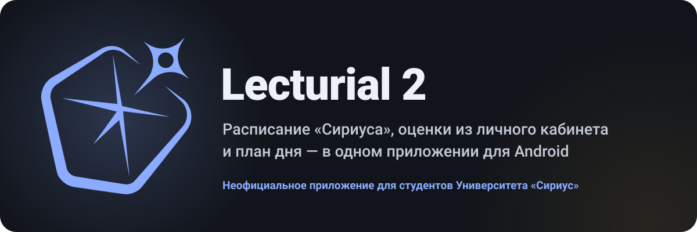
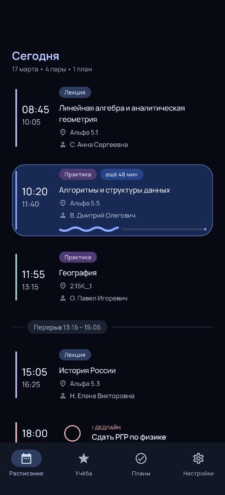
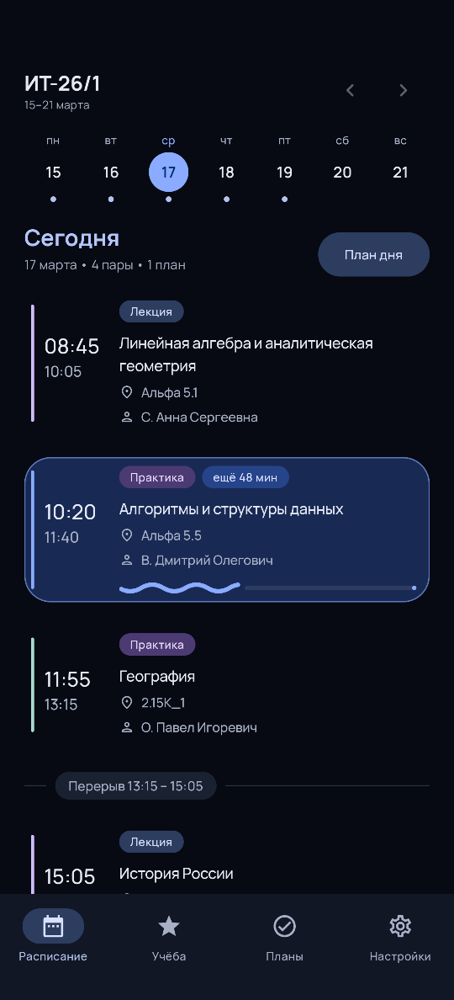
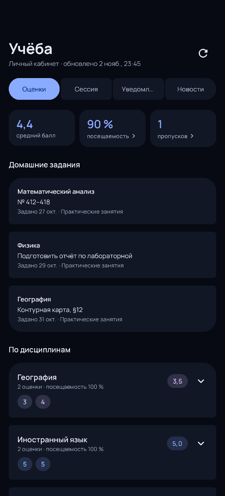
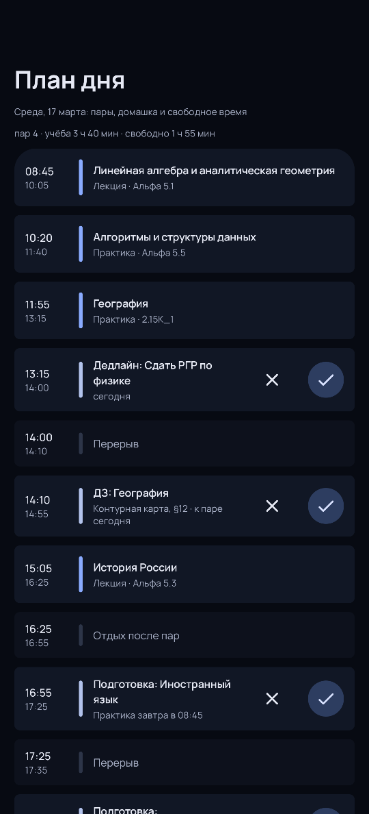

  

**An unofficial Android schedule app for Sirius University.** 
It works offline, shows grades from the student account and fits homework into your free time.

<a href="./README.md">Русская версия</a>

  

<b>Screenshots</b>

 

 

 

The group, teachers and grades in the clip and screenshots are made up. The app itself is in Russian.

## Features

- **Schedule** as a feed or a day at a time: the current class, time left, gaps between classes. Tutor hours and other events stay out of the way.
- **Student account.** Grades and absences on the lesson cards; a Study tab with attendance, homework, exams and credits, notifications and news. New grades arrive as notifications.
- **Day planner.** Homework, deadlines and getting ready for tomorrow fitted into the free time, re-planned as you tick things off.
- **Offline.** Loaded weeks stay on the phone.
- **Today widget**, reminders before a class and a notification for the current one.
- **Calendars.** Lessons and plans in Google Calendar or Outlook.
- **Statistics.** Free rooms, group and teacher load, shared gaps.
- **Looks.** Material You, 16 themes, custom palettes and live wallpapers.

## Install

Download [`Lecturial-2-v1.13.5.apk`](https://github.com/neckmnull/Lecturial-2/releases/download/v1.13.5/Lecturial-2-v1.13.5.apk), allow installs from your browser if Android asks, and open it. Installed versions update from **Settings → About → Updates**.
The SHA-256 of every release is in the [Russian README](./README.md#установка) and the release notes. Android 8.0 or newer.

Lecturial 2 is an independent project, not an official Sirius University app. It reads the university's schedule website, so a change there can break loading until the next update.

## Developers

Kotlin, Jetpack Compose and Material 3, Room, DataStore, OkHttp. Build with `./gradlew assembleDebug`; checks, requirements and the toolchain are in [CONTRIBUTING.md](./CONTRIBUTING.md), the design in [ARCHITECTURE.md](./docs/ARCHITECTURE.md) and [DESIGN.md](./docs/DESIGN.md), releases and the in-app updater in [PUBLISHING.md](./docs/PUBLISHING.md) and [UPDATER.md](./docs/UPDATER.md). In Russian: the [user guide](./docs/USER_GUIDE.md), the [developer guide](./docs/DEVELOPER_GUIDE.md) and the [security overview](./docs/SECURITY.md).

Licensed under [Apache 2.0](./LICENSE); Manrope under SIL OFL 1.1; third-party material in [THIRD_PARTY_NOTICES.md](./docs/THIRD_PARTY_NOTICES.md).
