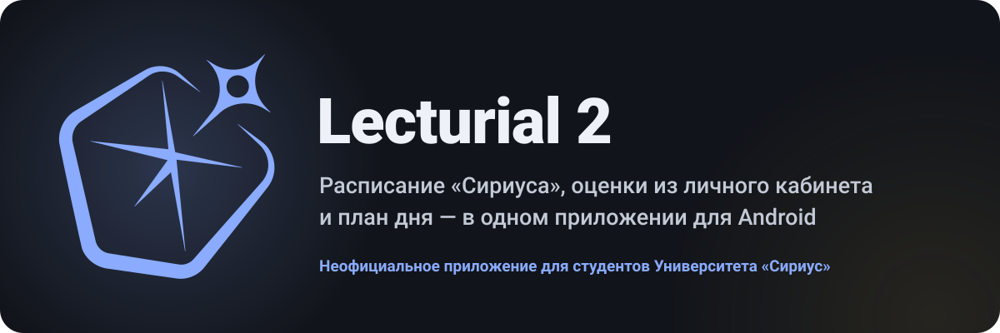
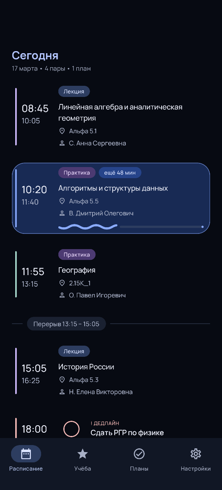
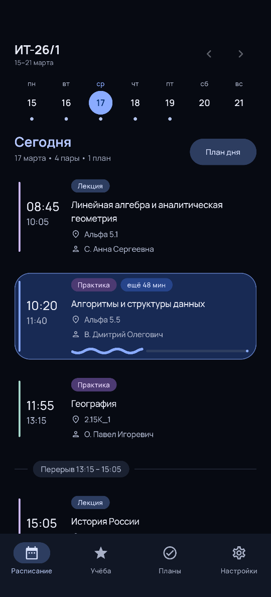
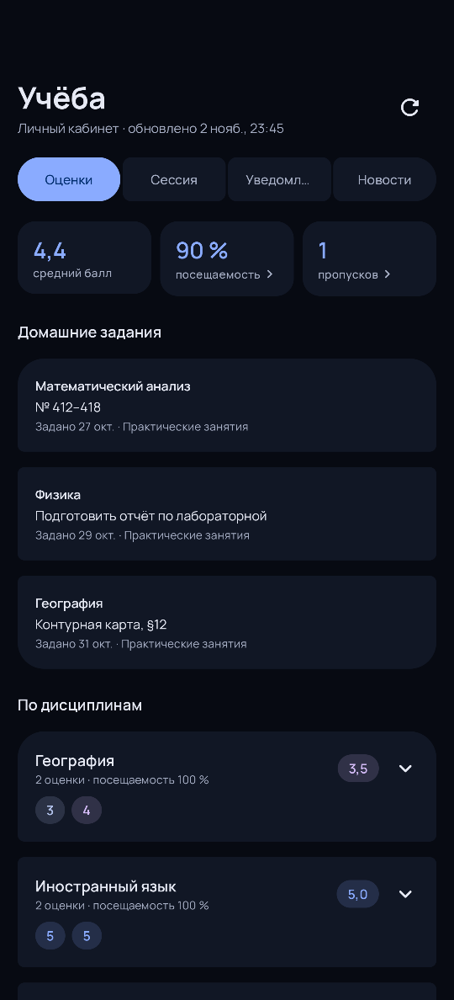
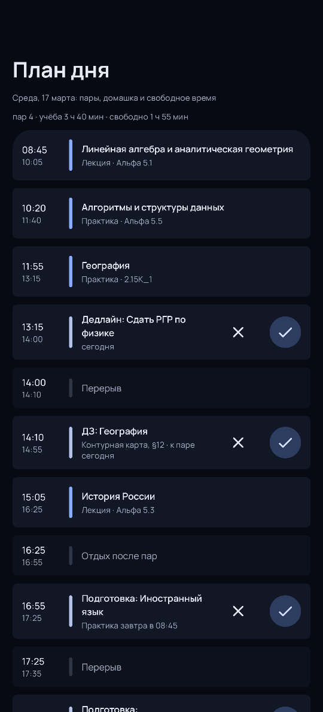

<div align="center">
  

<a href="https://github.com/neckmnull/Lecturial-2/releases/latest"></a>  <a href="./LICENSE"></a>

**Неофициальное приложение с расписанием Университета «Сириус» для Android.**<br />
Работает без интернета, показывает оценки из личного кабинета и само раскладывает домашку по свободному времени.

<a href="https://github.com/neckmnull/Lecturial-2/releases/download/v1.13.0/Lecturial-2-v1.13.0.apk"></a>
<a href="https://t.me/lecturial_2"></a>

<sub><a href="./README.en.md">English version</a></sub>

</div>

<p align="center">
  
</p>

<p align="center">
  
  
  
  
</p>
<p align="center"><sub>На скриншотах выдуманные группа, преподаватели и оценки.</sub></p>

## Что умеет

- **Расписание** лентой или по дням: какая пара сейчас, сколько до конца, где окна. Тьюторские часы и прочие мероприятия не мешают.
- **Личный кабинет.** Оценки и пропуски прямо на карточках пар, а во вкладке «Учёба» — посещаемость, домашние задания, сессия, уведомления и новости. Новые оценки приходят пушем.
- **План дня.** Домашка к следующей паре, дедлайны и подготовка к завтрашним парам раскладываются по свободному времени и перестраиваются, когда отмечаешь сделанное.
- **Без интернета.** Загруженные недели хранятся на телефоне.
- **Виджет «Сегодня»**, напоминания перед парой и уведомление с текущей парой.
- **Календари.** Пары и планы попадают в Google Календарь или Outlook.
- **Статистика.** Свободные аудитории, нагрузка групп и преподавателей, общие окна.
- **Оформление.** Material You, 16 готовых тем, свои палитры и живые обои.

## Установка

1. Скачай [`Lecturial-2-v1.13.0.apk`](https://github.com/neckmnull/Lecturial-2/releases/download/v1.13.0/Lecturial-2-v1.13.0.apk). Если приложение уже стоит, обнови его прямо в нём: **Настройки → О приложении → Обновления**.
2. Если Android спросит, разреши установку из браузера или файлового менеджера.
3. Открой APK и установи. При первом запуске приложение поможет выбрать группу и всё настроить.

<details>
<summary>Как проверить, что APK настоящий</summary>

```text
SHA-256  5e681708035f47758adff558d7eee453ae2b4f46c8644b1407df323f07e2d00d
Пакет    com.rassvet.lecturial2
```

Все релизы подписаны одним ключом, поэтому обновления ставятся поверх и данные сохраняются.
Если Android отказывается обновлять, значит, стоящая сейчас версия подписана другим ключом.
Lecturial 1 (`com.rassvet.lecturial`) — отдельное приложение, оба могут стоять рядом.
Все версии и списки изменений — на [странице релизов](https://github.com/neckmnull/Lecturial-2/releases).

</details>

## Вопросы

**Безопасно ли входить в личный кабинет?**
Вход идёт на странице lks.siriusuniversity.ru внутри приложения, пароль видит только сайт университета.
Приложение хранит лишь сессию, в зашифрованном виде на телефоне. Выйти можно во вкладке «Учёба».

**Это официальное приложение?**
Нет, это независимый проект. Расписание берётся с сайта университета, и если сайт изменится,
загрузка может сломаться до следующего обновления.

**Есть ли версия для iPhone?**
Нет, только Android 8.0 и новее.

**Где новости и куда писать?**
Новые версии выходят в [Telegram-канале @lecturial_2](https://t.me/lecturial_2). Ошибки и идеи —
в [Issues](https://github.com/neckmnull/Lecturial-2/issues).

## Для разработчиков

Kotlin, Jetpack Compose и Material 3, Room, DataStore, OkHttp. Собрать debug-версию:

```bash
git clone https://github.com/neckmnull/Lecturial-2.git
cd Lecturial-2
./gradlew assembleDebug
```

Сборка, проверки и требования к изменениям — в [CONTRIBUTING.md](./CONTRIBUTING.md).
Как устроено приложение — в [архитектуре](./docs/ARCHITECTURE.md), правила интерфейса — в [DESIGN.md](./DESIGN.md),
выпуск релизов и встроенное обновление — в [PUBLISHING.md](./docs/PUBLISHING.md) и [UPDATER.md](./docs/UPDATER.md).

---

<div align="center">
<sub>
Код и документация — под лицензией <a href="./LICENSE">Apache 2.0</a>, шрифт Manrope — SIL OFL 1.1,
сторонние материалы — в <a href="./THIRD_PARTY_NOTICES.md">THIRD_PARTY_NOTICES.md</a>.<br />
<a href="https://t.me/lecturial_2">Telegram</a> · <a href="https://github.com/neckmnull">@neckmnull</a>
</sub>
</div>
