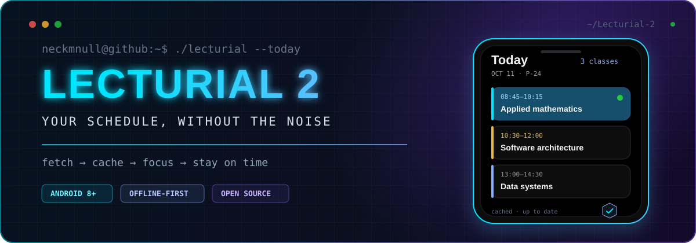

<div align="center">
  
</div>

<div align="center">

<a href="https://github.com/neckmnull/Lecturial-2/releases/latest"></a>   <a href="./LICENSE"></a>

**An unofficial, offline-first Android schedule app for Sirius University.**

<a href="https://github.com/neckmnull/Lecturial-2/releases/download/v1.10.1/Lecturial-2-v1.10.1.apk"></a>
<a href="https://github.com/neckmnull/Lecturial-2/releases/latest"></a>

</div>

<br />

```console
$ lecturial --about
Classes, rooms, instructors, reminders, and a home-screen widget—kept clear and close.

$ lecturial --pipeline
schedule source → local cache → app state → Compose UI → widget + notifications
```

## `01. Product signal`

Lecturial turns a changing university schedule into a calm daily view. It is designed
to stay useful with an unreliable connection, surface the class that matters now, and
keep common actions one tap away.

<table>
  <tr>
    <td width="50%" valign="top">
      <h3>◈ Read the day at a glance</h3>
      <p>Week navigation, lesson type, time, instructor, classroom, and current-class highlighting in one focused feed.</p>
    </td>
    <td width="50%" valign="top">
      <h3>◈ Keep working offline</h3>
      <p>Room-backed cache-first loading keeps previously viewed weeks available when the schedule site or network is not.</p>
    </td>
  </tr>
  <tr>
    <td width="50%" valign="top">
      <h3>◈ Make it yours</h3>
      <p>Material You wallpaper colors, light and dark modes, editable palettes, custom themes, self-drawing line wallpapers with gradients, typography controls, and schedule density presets.</p>
    </td>
    <td width="50%" valign="top">
      <h3>◈ See it outside the app</h3>
      <p>A Today widget that follows the app’s look and marks the current class, plus reminders, class boundaries, and an optional live notification.</p>
    </td>
  </tr>
</table>

## `02. Experience map`

| Area | What Lecturial provides |
|---|---|
| **Schedule** | Daily feed, week navigation, pull-to-refresh, current class, remaining time, and meaningful gaps |
| **Study context** | Group selection, foreign-language instructor selection, custom subject names, rooms, and instructors |
| **Offline behavior** | Cache-first loading with previously fetched weeks stored in Room |
| **Appearance** | Material You plus 11 built-in themes, custom palettes, light/dark modes, animated line wallpapers, gradient presets, font styles, sizing, spacing, and title wrapping |
| **At a glance** | Resizable Today widget that mirrors the app’s background and cards, marks the current class, and can be tuned separately |
| **Time awareness** | Reminders, start/end alerts, and a live notification for the current lesson |

> **Current release:** `1.10.1` (`versionCode 34`) · minimum Android version:
> Android 8.0 / API 26.

## `03. System map`

```text
Sirius schedule website
        │  cookies · CSRF · structured Livewire responses
        ▼
SiriusScheduleDataSource
        ▼
ScheduleRepository ───────────────► Room cache
        │                               │
        ▼                               └── offline weeks
ScheduleViewModel
        ├────────► Jetpack Compose UI
        ├────────► Today widget
        └────────► reminders + live notification

DataStore ───────► group · appearance · notification preferences
```

The adapter owns the website contract, the repository coordinates network and local
state, and the UI consumes a single observable schedule state. Cache updates also
synchronize the widget and notifications. Read the full
[architecture notes](./docs/ARCHITECTURE.md) and [design direction](./DESIGN.md).

## `04. Get the app`

### Install the signed release

1. Download [`Lecturial-2-v1.10.1.apk`](https://github.com/neckmnull/Lecturial-2/releases/download/v1.10.1/Lecturial-2-v1.10.1.apk), or use **Settings → About → Updates** in an older version.
2. Allow installation from your browser or file manager if Android requests it.
3. Open the APK and install or update Lecturial 2.

```text
SHA-256  76b02194c410dd502dc7fe79855ba0a0d746b02b11b04895449591d8340f0c14
Package  com.rassvet.lecturial2
```

The release APK is signed for in-place updates. Android will reject an update if the
installed app was signed with a different key. See all builds and release notes on the
[Releases page](https://github.com/neckmnull/Lecturial-2/releases).

> [!NOTE]
> The previous v1.4.5 APK uses the legacy package `com.rassvet.lecturial`.
> Starting with v1.5.0, Lecturial 2 uses `com.rassvet.lecturial2` and installs alongside
> Lecturial 1. This first release with the new package is a separate installation;
> subsequent Lecturial 2 releases will update it in place when signed with the same key.

> [!IMPORTANT]
> Lecturial 2 is an independent project and is **not** an official Sirius University
> application. Schedule availability depends on the university website and its current
> Livewire contract.

### Required updates

A release can make older versions update before they can be used again. Add a hidden
line to the release notes on GitHub:

```html
<!-- lecturial-min-version: 1.11.0 -->
```

Installed versions older than that show only an update screen with a download button,
on the next start (the app checks about every four hours) or from the update
notification. Keep the line in later releases while the requirement matters: the app
reads the latest release only. Without the line, updates stay optional.

## `05. Build and verify`

### Requirements

- JDK 17
- Android Studio compatible with Android Gradle Plugin 9.3.1
- Android SDK Platform 37 and Build Tools 36.0.0
- An Android 8.0+ device or emulator

```powershell
git clone https://github.com/neckmnull/Lecturial-2.git
Set-Location Lecturial-2
.\gradlew.bat assembleDebug
```

On Linux or macOS:

```bash
git clone https://github.com/neckmnull/Lecturial-2.git
cd Lecturial-2
chmod +x gradlew
./gradlew assembleDebug
```

The debug APK is written to `app/build/outputs/apk/debug/app-debug.apk`. Its package
name is `com.rassvet.lecturial.debug`, so debug and release builds can be installed
side by side without sharing app data.

Run the local verification suite with:

```powershell
.\gradlew.bat testDebugUnitTest lintDebug
.\gradlew.bat connectedDebugAndroidTest # requires a device or emulator
```

<details>
<summary><strong>Live-site test and signed release build</strong></summary>

The live integration test is intentionally opt-in because it depends on network access
and the schedule website's current contract:

```powershell
$env:LECTURIAL_LIVE_TEST = '1'
.\gradlew.bat testDebugUnitTest --tests '*SiriusLiveIntegrationTest' --rerun-tasks
Remove-Item Env:LECTURIAL_LIVE_TEST
```

To build signed APK/AAB artifacts, copy the secret-free template and provide your own
release key values:

```powershell
Copy-Item keystore.properties.example keystore.properties
.\gradlew.bat assembleRelease bundleRelease
```

Signing keys, passwords, generated artifacts, and local SDK configuration are excluded
from Git. Without signing configuration, release outputs are not ready for installation
or store submission.

</details>

<details>
<summary><strong>Toolchain and dependencies</strong></summary>

| Component | Version / choice |
|---|---|
| Language and UI | Kotlin with Jetpack Compose |
| `compileSdk` / `targetSdk` | 37 / 37 |
| JDK | 17 |
| Gradle Wrapper | 9.5.0 |
| Android Gradle Plugin | 9.3.1 with built-in Kotlin support |
| Compose Compiler plugin | 2.3.21 |
| Compose BOM | 2026.08.00 |
| Material 3 | 1.5.0-alpha27 |
| Persistence | Room 2.8.4 and DataStore 1.2.1 |
| Networking | OkHttp 5.1.0 and Kotlin serialization JSON |

</details>

## `06. Repository map`

| Path | Purpose |
|---|---|
| [`app/src/main`](./app/src/main) | Production UI, data layer, resources, widget, and notifications |
| [`app/src/test`](./app/src/test) | JVM unit and contract tests |
| [`app/src/androidTest`](./app/src/androidTest) | Android integration and Compose UI tests |
| [`docs/ARCHITECTURE.md`](./docs/ARCHITECTURE.md) | Layers, responsibilities, data flow, and state ownership |
| [`docs/UPDATER.md`](./docs/UPDATER.md) | In-app update flow, release contract, security boundaries, and troubleshooting (Russian) |
| [`docs/knowledge-base/00-Lecturial-Hub.md`](./docs/knowledge-base/00-Lecturial-Hub.md) | Obsidian-ready project context, linked notes, runbooks, and Mermaid graphs |
| [`DESIGN.md`](./DESIGN.md) | Interface hierarchy, palette, accessibility, and widget direction |
| [`CONTRIBUTING.md`](./CONTRIBUTING.md) | Contribution workflow and verification expectations |
| [`THIRD_PARTY_NOTICES.md`](./THIRD_PARTY_NOTICES.md) | Fonts, third-party material, schedule data, and dependency notices |
| [`docs/PUBLISHING.md`](./docs/PUBLISHING.md) | Repository and signed-release checklist |

## `07. Scope and contribution`

- Only previously cached weeks are available offline, and cached data can become stale.
- The schedule website does not expose a stable public API; upstream changes can break
  synchronization until the adapter is updated.
- Notifications are subject to Android permissions and background-execution limits.
- Material 3 is currently pinned to an alpha release.

Issues and focused pull requests are welcome. Before contributing, read the
[contribution guide](./CONTRIBUTING.md), explain the behavior change, run the relevant
checks, and remove personal schedule data from screenshots and logs.

Original code and documentation are available under the
[Apache License 2.0](./LICENSE). Manrope is licensed under SIL OFL 1.1. Third-party
names, logos, and schedule data are not relicensed; details are in
[THIRD_PARTY_NOTICES.md](./THIRD_PARTY_NOTICES.md).

---

<div align="center">
  <b>Built to make the next class obvious.</b><br /><br />
  <a href="https://github.com/neckmnull">@neckmnull</a>
  <br /><br />
  <sub>Understand the system · Remove the noise · Ship something useful</sub>
</div>