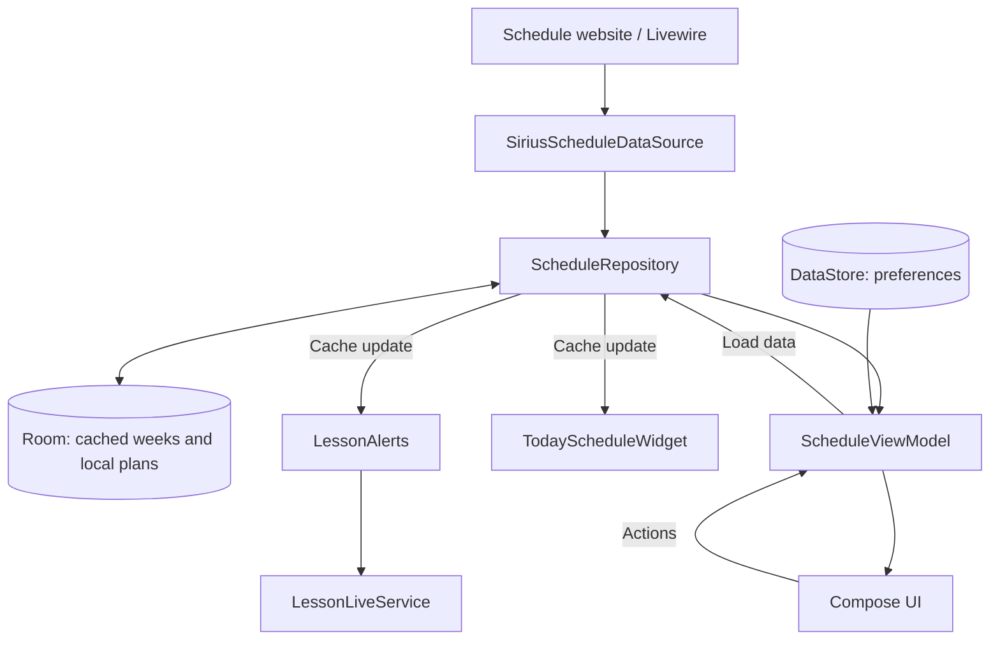

# Lecturial 2 architecture

Lecturial 2 has one Android module, `app`, a Jetpack Compose UI, and manually constructed dependencies in `LecturialApplication`.

## Data flow

## Layers and responsibilities

| Package / file | Responsibility |
| --- | --- |
| `MainActivity` | Android Activity and Compose entry point |
| `LecturialApplication` | Preferences, database, repository instances, and initial synchronization |
| `data/network` | HTTPS, cookies, CSRF, Livewire calls, and JSON conversion |
| `data/local/ScheduleDatabase.kt` | Room storage for schedule weeks |
| `data/local/UserPreferences.kt` | Group, language instructor, subject aliases, theme, and widget preferences |
| `data/ScheduleRepository.kt` | Network access, cache reads and updates, and consumer notifications |
| `data/StudyPlanRepository.kt` | Local goals, tasks, and deadlines stored in Room |
| `model` | Models, formatting, time calculations, and appearance settings |
| `ui/ScheduleViewModel.kt` | Screen state, date/group selection, loading, and settings actions |
| `ui/LecturialApp.kt` | Screens and Compose components |
| `ui/theme` | Persistent dark app themes |
| `notify` | AlarmManager integration, notifications, receivers, and foreground service |
| `widget` | AppWidgetProvider and RemoteViewsService-backed collection |

## Loading and offline behavior

The cache-first strategy displays stored data before a network request completes. A successful response updates the Room cache. Weeks are keyed by group and week start. Existing cached schedules may remain available after an error, but the first load requires network access.

The Livewire adapter is isolated from the UI. It retrieves page state, maintains cookies and CSRF values, invokes the server component, and parses its structured response. When the website changes, inspect `SiriusScheduleDataSource.kt` and the existing network tests first.

## Notifications and widget

`LessonAlertPlanning.kt` calculates event times. `LessonAlerts` schedules events and creates notifications. `LessonAlertReceiver.kt` handles alarms, reboot, package updates, time changes, and exact-alarm permission changes. `LessonLiveService` updates the current-class state.

The widget uses RemoteViews. Resources and DataStore preferences define its appearance. It combines today's cached lessons with an active-plan summary from Room. A schedule cache or plan update triggers a widget refresh; schedule updates also synchronize notifications.

## Where to change behavior

- Group loading and search: `data/network/SiriusScheduleDataSource.kt`; UI and state live in `ui/LecturialApp.kt` and `ui/ScheduleViewModel.kt`.
- Time and label formatting: `model/ScheduleDisplay.kt`.
- Foreign-language filtering: `model/LanguageTeacher.kt`.
- Screens: `ui/LecturialApp.kt`; state and actions: `ui/ScheduleViewModel.kt`.
- Widget: `model/WidgetAppearance.kt`, `data/local/UserPreferences.kt`, `widget/TodayScheduleWidget.kt`, and `res/layout/`.
- Notifications: `model/LessonAlertPlanning.kt` and `notify/`.
- Network contract: `data/network/SiriusScheduleDataSource.kt`.

## Existing checks

`src/test` covers formatting, instructor selection, rest hints, parsing, and the network adapter, plus an optional live-site integration test. `src/androidTest` contains Compose UI and repository tests. `src/debug` provides the Activity required by UI tests.

Commands are listed in the [README](../README.md). A build does not replace physical-device verification of notifications and the widget.