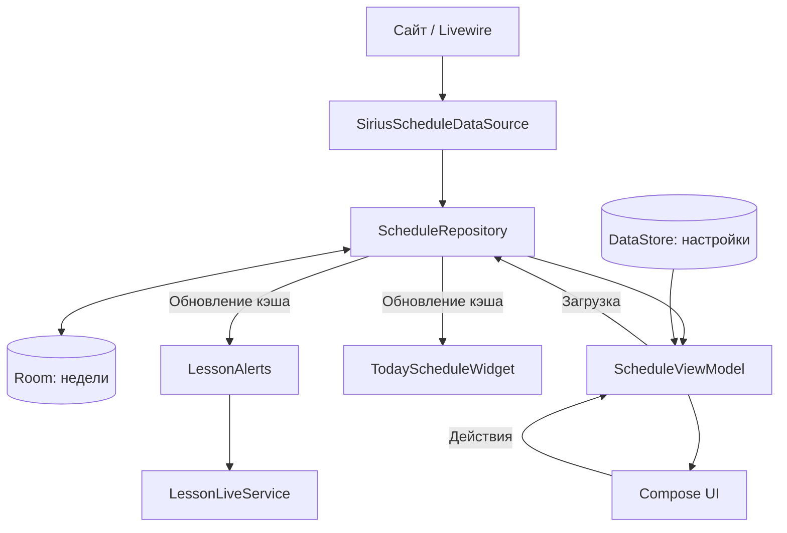

# Архитектура Lecturial 2

Один Android-модуль `app`, интерфейс Jetpack Compose, ручное создание зависимостей в `LecturialApplication`.

## Поток данных

## Слои и ответственность

| Пакет / файл | Ответственность |
| --- | --- |
| `MainActivity` | Android Activity и запуск интерфейса |
| `LecturialApplication` | Экземпляры настроек, базы и репозитория; начальная синхронизация |
| `data/network` | HTTPS, cookies, CSRF, Livewire, преобразование JSON |
| `data/local/ScheduleDatabase.kt` | Room-хранилище недель |
| `data/local/UserPreferences.kt` | Группа, преподаватель языка, псевдонимы предметов и настройки виджета |
| `data/ScheduleRepository.kt` | Сеть, чтение и обновление кэша, уведомление потребителей |
| `model` | Модели, форматирование, расчёты времени и настройки оформления |
| `ui/ScheduleViewModel.kt` | Состояние экрана, выбор даты и группы, загрузка и настройки |
| `ui/LecturialApp.kt` | Экраны и Compose-компоненты |
| `ui/theme` | Тёмная тема приложения |
| `notify` | AlarmManager, уведомления, receivers и foreground service |
| `widget` | AppWidgetProvider и список через RemoteViewsService |

## Загрузка и офлайн

Cache-first подход позволяет показать сохранённые данные до завершения сетевой загрузки. Успешная загрузка обновляет Room-кэш. Недели относятся к конкретной группе и началу недели. При ошибке ранее сохранённое расписание может оставаться доступным; для первого получения данных нужна сеть.

Livewire-адаптер изолирован от UI. Он получает состояние страницы, работает с cookies и CSRF, вызывает серверный компонент и разбирает структурированный ответ. При изменении сайта сначала проверяйте `SiriusScheduleDataSource.kt` и существующие сетевые тесты.

## Уведомления и виджет

`LessonAlertPlanning.kt` вычисляет время событий. `LessonAlerts` планирует их и формирует уведомления. `LessonAlertReceiver.kt` содержит обработчики alarm, перезагрузки, обновления пакета, изменения времени и разрешения точных alarm. `LessonLiveService` обновляет состояние текущей пары.

Виджет использует RemoteViews. Его оформление задаётся ресурсами и настройками DataStore. Обновление кэша инициирует обновление виджета и синхронизацию уведомлений.

## Где менять поведение

- Группы и их поиск загружаются через Livewire: `data/network/SiriusScheduleDataSource.kt`; UI и состояние находятся в `ui/LecturialApp.kt` и `ui/ScheduleViewModel.kt`.
- Формат времени и подписей: `model/ScheduleDisplay.kt`.
- Фильтрация иностранного языка: `model/LanguageTeacher.kt`.
- Экраны: `ui/LecturialApp.kt`, состояние и действия: `ui/ScheduleViewModel.kt`.
- Виджет: `model/WidgetAppearance.kt`, `data/local/UserPreferences.kt`, `widget/TodayScheduleWidget.kt`, `res/layout/`.
- Уведомления: `model/LessonAlertPlanning.kt` и `notify/`.
- Сетевой контракт: `data/network/SiriusScheduleDataSource.kt`.

## Существующие проверки

`src/test` содержит проверки форматирования, выбора преподавателя, подсказок о перерывах, парсера и сетевого адаптера, а также опциональный тест сайта. `src/androidTest` содержит Compose UI и тесты репозитория. `src/debug` предоставляет Activity для UI-тестов.

Команды находятся в [README](../README.md). Сборка не заменяет проверку уведомлений и виджета на устройстве.
