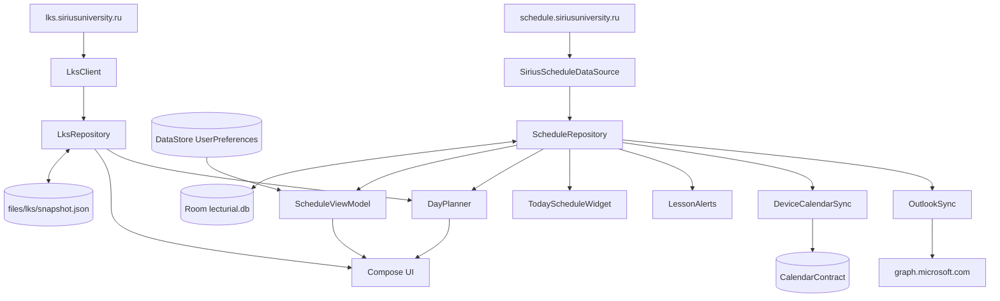

# Руководство разработчика Lecturial 2

Как устроен код, где что менять и как выпустить версию. Описано состояние 1.13.3.

Остальная документация:

| Документ | О чём |
| --- | --- |
| [CONTRIBUTING.md](../CONTRIBUTING.md) | Требования к окружению, команды сборки и проверок, правила PR |
| [ARCHITECTURE.md](./ARCHITECTURE.md) | Краткая схема слоёв (на английском) |
| [DESIGN.md](./DESIGN.md) | Правила интерфейса, Material 3 Expressive |
| [UPDATER.md](./UPDATER.md) | Встроенное обновление: поток, состояния, проверки |
| [PUBLISHING.md](./PUBLISHING.md) | Публикация репозитория и релизов |
| [SECURITY.md](./SECURITY.md) | Данные, сеть, шифрование, остаточные риски |
| [USER_GUIDE.md](./USER_GUIDE.md) | Что видит пользователь |

## Быстрый старт

Нужны JDK 17, Android SDK Platform 37 и Build Tools 36.0.0. Остальное в
[CONTRIBUTING.md](../CONTRIBUTING.md#building-and-checking).

```bash
./gradlew assembleDebug
./gradlew testDebugUnitTest lintDebug
./gradlew connectedDebugAndroidTest
```

Debug-сборка ставится как `com.rassvet.lecturial2.debug` рядом с release и не делит
с ней данные.

**Windows и кириллица в пути.** Если путь к проекту содержит не-ASCII символы,
`gradlew.bat` и временные файлы Gradle могут ломаться. Подключите папку проекта
как отдельный диск и вынесите `GRADLE_USER_HOME` и временную папку в путь
из латиницы:

```powershell
subst L: 'C:\путь\к\Lecturial-2'
$env:GRADLE_USER_HOME = 'C:\lecturial-gradle-home'
$t = 'C:\lecturial-gradle-home\tmp'; $env:TEMP = $t; $env:TMP = $t
Set-Location L:\
.\gradlew.bat assembleDebug "-Djava.io.tmpdir=$t"
Set-Location C:\; subst L: /d
```

## Устройство приложения

Один модуль `app`. Зависимости собираются вручную в `LecturialApplication`, DI-фреймворка
нет. Интерфейс на Jetpack Compose и Material 3 Expressive, строки интерфейса на русском
прямо в коде.



### Пакеты

| Пакет | Что внутри |
| --- | --- |
| `model/` | Чистая логика без Android: модели расписания, форматирование, план дня, оценки, сравнение для синхронизации календарей, обои. Почти вся покрыта unit-тестами |
| `data/network/` | `SiriusScheduleDataSource` (Livewire сайта расписания), `GitHubUpdateChecker` |
| `data/local/` | Room (`ScheduleDatabase`), DataStore (`UserPreferences`), `SecretBox`, `DayPlannerStore`, кеш полей обоев |
| `data/lks/` | `LksClient` (HTTP и разбор страниц ЛКС), `LksRepository` (состояние, снимок, фоновое обновление, уведомления) |
| `data/devicecalendar/` | Google Календарь через `CalendarContract` |
| `data/outlook/` | Вход в Microsoft (PKCE), Microsoft Graph, синхронизация |
| `data/` | `ScheduleRepository`, `StudyPlanRepository`, `ScheduleAnalyticsRepository`, общий `CalendarSyncSupport` |
| `ui/` | Экраны, `ScheduleViewModel`, `AnalyticsViewModel`, первая настройка, оформление |
| `notify/` | Будильники, уведомления, `LessonLiveService`, receivers |
| `widget/` | Виджет «Сегодня» на RemoteViews и его фон |

## Хранение данных

| Хранилище | Что | Как менять |
| --- | --- | --- |
| Room `lecturial.db`, версия 5 | `schedule_events`, `week_cache`, `study_plans` | Поднять `version` и добавить `Migration` в `ScheduleDatabase.kt`. `exportSchema = false`, поэтому миграцию проверяйте тестом в `androidTest/.../data/local` |
| DataStore `UserPreferences` | Группа, настройки, сокращения. `AppDisplayOptions` хранится одной JSON-строкой | Новое поле получает значение по умолчанию, а разбор не должен падать на старом JSON без него (см. `parseAppDisplayOptions`) |
| SharedPreferences | `first_run`, `day_planner`, `lks`, `device_calendar_sync`, `outlook_auth` | Секреты только через `SecretBox` |
| Файлы | `files/lks/snapshot.json`, записи о синхронизированных событиях, кеш поля «Лабиринта» | — |

Бэкап выключен (`allowBackup=false` и `data_extraction_rules.xml`). Если
добавляете новое хранилище, бэкап его тоже не заберёт, ничего настраивать не нужно.

## Расписание

- `SiriusScheduleDataSource` достаёт состояние Livewire-компонента со страницы,
  держит cookie и CSRF, вызывает компонент и разбирает JSON. Если сайт поменялся,
  начинайте отсюда и с тестов в `src/test/.../data/network`.
- `ScheduleRepository` работает от кеша: сначала показывает сохранённые недели,
  потом обновляет их из сети. Недели хранятся по ключу расписания и началу недели.
- Внеучебные мероприятия (тьюторские часы, встречи, экскурсии) показываются по умолчанию.
  `ExtracurricularChoice` (настройки `show_extracurricular` и `hidden_extracurricular`)
  скрывает все сразу или отдельные по названию в расписании группы: `forShowing()` и
  `eventsBetween()` для ленты, напоминаний и календарей, `todayLessons()` для виджета.
  В кеше они остаются всегда, поэтому выбор работает без сети, а экран настройки берёт
  названия из кеша (`extracurricularNames`). Признак в `isExtracurricular`
  (`model/ScheduleDisplay.kt`): вид занятия или начало названия. Счётчики пар их не считают.
  План дня учитывает их как занятое время, но не предлагает к ним готовиться.
- Фильтр преподавателя иностранного языка: `model/LanguageTeacher.kt`.

## Личный кабинет (ЛКС)

- **Вход.** `LksLoginScreen` открывает страницу входа в WebView. Когда загрузилась
  страница ЛКС, отличная от входа, cookie из `CookieManager` передаются в
  `LksRepository`, который шифрует их `SecretBox("lecturial_lks_session")` и стирает
  cookie и хранилище WebView. Сам WebView пускает только на `*.siriusuniversity.ru`,
  экран закрыт `FLAG_SECURE`. Ослаблять эти ограничения нельзя: на них опирается
  [SECURITY.md](./SECURITY.md).
- **Загрузка.** `LksClient` ходит OkHttp с `SessionJar` (cookie только для хоста ЛКС
  и только по HTTPS) и разбирает HTML и `wire:initial-data` через jsoup.
  `LksSignedOutException` значит, что сессия истекла.
- **Снимок.** Результат сохраняется в `files/lks/snapshot.json`, зашифрованный тем же
  ключом, что и сессия. Интерфейс читает его сразу при запуске.
- **Фон.** `LksRefreshReceiver` по `AlarmManager` раз в 3 часа, расписание
  восстанавливается в `BootCompletedReceiver`. Новые оценки и уведомления уходят
  в канал «Личный кабинет».
- **Сдано или нет.** Флаг `passed` у дисциплины в ЛКС всегда `true`, настоящий статус
  лежит в `actionType[*].passed`. Используйте `passedControls(...)` из `model/Lks.kt`.
- **Сессия.** `model/Assessment.kt`: вид контроля (`AssessmentKind`), пояснения
  и подсказки по журналу.

## Календари

Общая логика в `model/CalendarSync.kt`: из желаемых событий и того, что уже записано,
строится список создать, изменить и удалить.

**Google Календарь** (`data/devicecalendar/`):

- Каждое событие помечается `CUSTOM_APP_PACKAGE` и `CUSTOM_APP_URI`
  (`lecturial2://calendar/<ключ>`), а в описание добавляется `LESSON_MARK` или
  `PLAN_MARK`. Если провайдер календаря не принимает `CUSTOM_APP_*`, остаётся метка
  в описании.
- Перед синхронизацией `adoptMarked` сверяется с самим календарём: помеченные события,
  которых нет в локальной записи (переустановка, другая сборка), подхватываются,
  лишние копии удаляются. Так не бывает дублей.
- Удалять можно только события со своей меткой. Чужие события не трогаем никогда.
- Отключение и смена календаря вызывают `removeEverything`.

**Outlook** (`data/outlook/`): `MicrosoftAuth` (PKCE, обмен и обновление токенов),
`TokenVault` (токены под ключом Keystore), `GraphCalendar` (запросы к Graph),
`OutlookSync` (состояние и синхронизация). Client ID задаётся свойством Gradle
`lecturial.msClientId`, без него Outlook скрыт.

## План дня

Чистые функции в `model/DayPlanner.kt`:

- `studyTasks(...)` собирает дела: домашку к следующей паре по предмету, дедлайны,
  подготовку к завтрашним парам и повторение предметов, давно не изучавшихся
  (`REVIEW_DAYS = 14`). Физкультура исключена.
- `planDay(...)` раскладывает их по свободным окнам (`freeWindows`) блоками
  `blockMinutes` с перерывами, после отдыха `restMinutes` от последней пары
  и не больше `maxStudyMinutes` в день. Окна короче `MIN_WINDOW` пропускаются,
  до первой пары дела ставятся только при утреннем окне не меньше `MORNING_WINDOW`.
- Отметки «Сделано» и «Отложить» хранит `DayPlannerStore`.
- Интерфейс: `ui/DayPlannerSection.kt`. В режиме преподавателя план не показывается.

## Уведомления и виджет

`model/LessonAlertPlanning.kt` считает время событий, `notify/LessonAlerts` ставит
будильники и показывает уведомления, `LessonLiveService` держит уведомление с текущей
парой. Сроки планов: `model/DeadlineReminderPlanning.kt` и `notify/DeadlineAlerts.kt`.
Виджет обновляется при изменении кеша расписания или планов. Подробнее в
[ARCHITECTURE.md](./ARCHITECTURE.md#notifications-and-widget).

## Оформление и обои

- `model/AppAppearance.kt`: `AppDisplayOptions`, стили фона (`AppBackgroundStyle`),
  вид расписания (`ScheduleLayout`), пресеты градиентов.
- Линейные обои (`model/WallpaperPatterns.kt`, `ui/LinePatternBackground.kt`):
  каждый узор рендерится в плитку ALPHA_8 с маской линий и порядком прорастания,
  плитка повторяется через `BitmapShader`. На API 33+ прорастание анимирует AGSL
  `RuntimeShader`, цвет накладывается градиентом. Поле «Лабиринта» дорогое, поэтому
  кешируется на диске (`WallpaperFieldCache`).
- «Свой рисунок»: `model/WallpaperMotif.kt` (штрихи, прореживание, `fitted()`,
  поворот вертушкой `pinwheelTurns`, кодирование в строку), `ui/MotifTiles.kt`
  (плитка из копий), `ui/MotifEditor.kt` (рисование пальцем). Размер узора ограничен
  `MAX_STROKES` и `MAX_POINTS`.
- Виджет рисует те же обои в `widget/WidgetWallpaper.kt`.

Правила интерфейса и анимаций в [DESIGN.md](./DESIGN.md).

## Первая настройка

`ui/FirstRunSetup.kt`, объект `FirstRun`. Шаги: приветствие, группа или преподаватель,
личный кабинет, уведомления, оформление, вид расписания, готово. Показывается, пока
не пройдена и не выбрана группа. `FirstRun.replay()` запускает её заново из
«О приложении». Новый шаг: добавить значение в `SetupStep` и ветку в `when`.

## Тесты

| Где | Что |
| --- | --- |
| `src/test/.../model` | Логика: план дня, оценки, ЛКС, синхронизация календарей, обои, форматирование, аналитика |
| `src/test/.../data` | Разбор сайта расписания, Outlook, календарь, хранилище |
| `src/test/.../ui` | Вычисления для экранов без Compose |
| `src/androidTest` | Compose UI, репозитории, Room, `DeviceCalendarTest` (на устройстве) |

Живой тест сайта расписания включается переменной `LECTURIAL_LIVE_TEST=1`.

**Скриншоты и ролик для README** рисуются тестом `ReadmeScreenshots` на выдуманных
данных, команды в [CONTRIBUTING.md](../CONTRIBUTING.md#building-and-checking).

Новая нетривиальная логика (разбор, планирование, синхронизация) получает unit-тест
в `src/test`. Уведомления, виджет и календарь всё равно проверяйте на телефоне.

## Выпуск версии

1. Поднять `versionCode` и `versionName` в `app/build.gradle.kts`.
2. `testDebugUnitTest lintDebug`, затем `assembleRelease` с release-ключом
   (`keystore.properties`, в git не попадает).
3. Проверить обновление поверх прошлой версии на телефоне без потери данных.
4. В `README.md` и `README.en.md` обновить ссылку на APK, версию и SHA-256.
5. Коммит, тег `vX.Y.Z`, GitHub Release с заметками на английском и ровно одним APK
   `Lecturial-2-vX.Y.Z.apk`.
6. Если старые версии должны обязательно обновиться, добавить в заметки скрытую строку
   `<!-- lecturial-min-version: X.Y.Z -->` (см. [PUBLISHING.md](./PUBLISHING.md#required-updates)).
7. Пост в [Telegram-канал](https://t.me/lecturial_2).

Сообщение коммита: короткая первая строка, пустая строка, затем подробности.
Без пустой строки GitHub покажет весь текст как заголовок.

## Типовые задачи

**Сайт расписания или ЛКС поменялся.** Сохраните новую страницу или ответ как фикстуру,
добавьте тест в `src/test`, поправьте `SiriusScheduleDataSource` или `LksClient`.
Если старые версии из-за этого сломаются, выпустите обязательное обновление.

**Новая настройка оформления.** Поле в `AppDisplayOptions` со значением по умолчанию,
запись и чтение в `UserPreferences.kt`, элемент в `ui/AppearanceSettings.kt`, тест
на сохранение и чтение старого JSON без поля.

**Новая колонка в Room.** Поле в сущности, `version + 1`, `Migration` с
`ALTER TABLE`, регистрация в `addMigrations(...)`.

**Новый вид событий в календаре.** Ключ события должен быть стабильным, а метка
обязательна, иначе после переустановки появятся дубли.

**Новое разрешение или сетевой адрес.** Обновите [SECURITY.md](./SECURITY.md)
и текст экрана «Конфиденциальность» в `ui/SettingsScreens.kt`.

**Новые личные данные.** Всё, что приходит из ЛКС или от будущего API университета,
хранится через `SecretBox`, а уведомления с такими данными получают
`VISIBILITY_PRIVATE` и публичную версию без содержимого.

**Обновление Gradle.** Вместе с `distributionUrl` поменяйте `distributionSha256Sum`
в `gradle/wrapper/gradle-wrapper.properties` на сумму с services.gradle.org.
