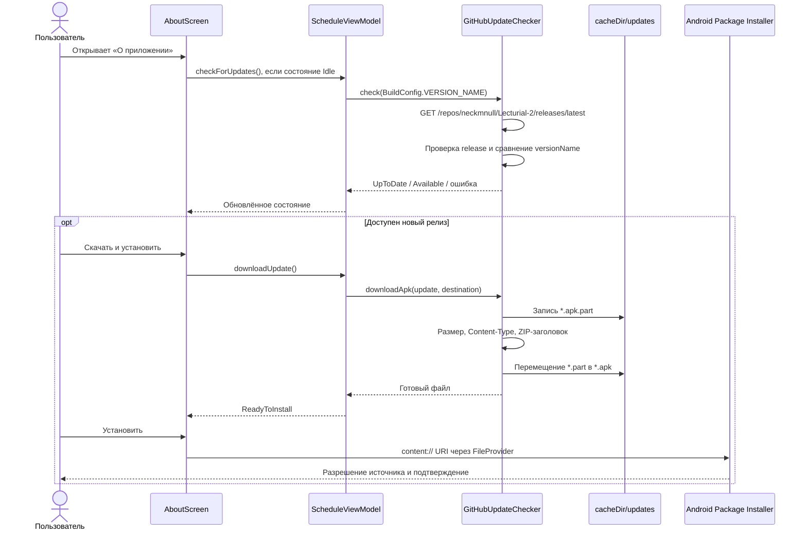
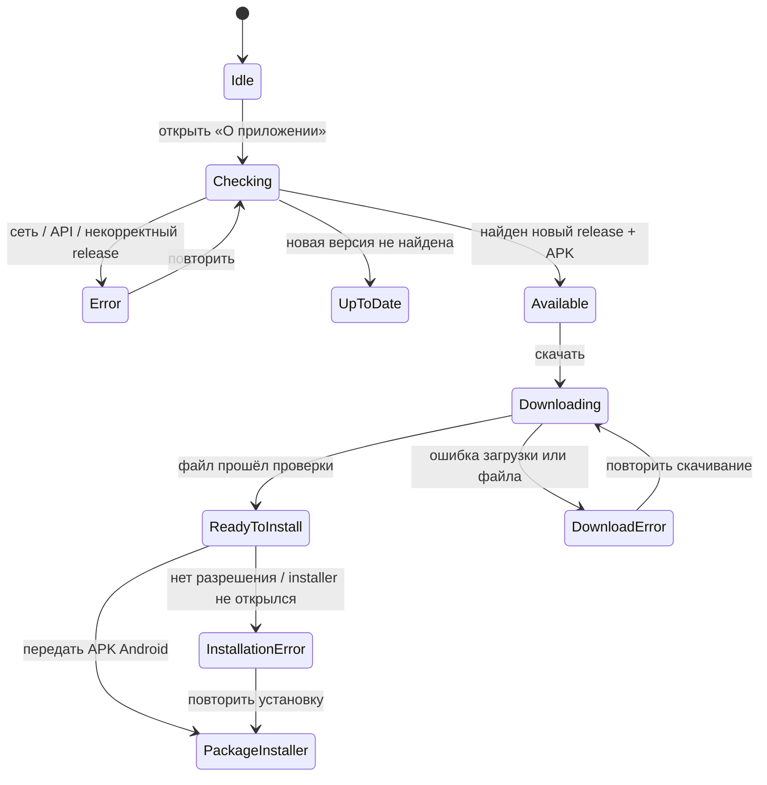

# Обновления Lecturial 2

Этот документ описывает встроенный updater Lecturial 2: пользовательский сценарий,
контракт GitHub Release, реализацию, проверки безопасности и порядок диагностики.

## Кратко

| Версия приложения | Возможности updater |
|---|---|
| `v1.6.0` | Проверяет последний стабильный GitHub Release и открывает его страницу. APK пользователь скачивает через браузер. |
| `v1.6.1` и новее | Проверяет релиз, скачивает APK в приватный кэш приложения и передаёт его системному Android Package Installer. |

Важно: установленная `v1.6.0` не получает новые возможности updater динамически.
Поэтому переход **с `v1.6.0` на `v1.6.1`** выполняется через страницу GitHub Release.
Встроенная загрузка доступна только после установки `v1.6.1` и используется для
последующих релизов.

## Пользовательский сценарий

Откройте **Настройки → О приложении**. Отдельного вложенного экрана
«Обновления» нет: карточка updater находится прямо на экране «О приложении».

При первом открытии экрана в текущем процессе проверка запускается автоматически.
Дальнейшее поведение зависит от результата:

1. **Установлена актуальная версия** — обновление не требуется.
2. **Доступна новая версия** — можно открыть GitHub Release или нажать
   **Скачать и установить**.
3. Во время загрузки отображается процент, если сервер сообщил размер файла.
   Если размер неизвестен, отображается индикатор без процентов.
4. После загрузки необходимо отдельно нажать **Установить**.
5. На Android 8.0+ система может попросить разрешить Lecturial 2 устанавливать
   неизвестные приложения.
6. Android Package Installer показывает системный экран. Пользователь должен
   подтвердить обновление вручную; бесшумная установка не поддерживается.

Название кнопки **Скачать и установить** означает запуск процесса обновления, но
не отменяет отдельное системное подтверждение и промежуточную кнопку
**Установить** после скачивания.

## Полный поток



## Как определяется новая версия

Updater запрашивает:

```text
https://api.github.com/repos/neckmnull/Lecturial-2/releases/latest
```

Затем он:

1. проверяет, что ответ описывает не `draft` и не `prerelease`;
2. требует непустой `tag_name` и `html_url` из ожидаемого репозитория;
3. нормализует tag, удаляя начальную `v` и суффикс после `-` или `+`;
4. сравнивает числовые сегменты версии слева направо;
5. сообщает об обновлении, только если версия release новее текущего
   `BuildConfig.VERSION_NAME`;
6. для нового релиза выбирает первый `.apk` asset с допустимым download URL.

Примеры сравнения:

| Текущая версия | Tag release | Результат |
|---|---|---|
| `1.6.1` | `v1.6.1` | актуальная версия |
| `1.6.1` | `v1.7.0` | доступно обновление |
| `1.6.1-debug` | `v1.6.1` | версии считаются равными |
| `1.9.9` | `v1.10.0` | доступно обновление |

Проверка доступности использует **`versionName`**, а окончательное решение о
допустимости upgrade принимает Android по `applicationId`, `versionCode`, подписи
и совместимости APK. Поэтому каждый новый release обязан одновременно повышать
`versionName` и `versionCode`.

## Состояния updater

| Состояние | Что означает | Доступное действие |
|---|---|---|
| `Idle` | Проверка в этом процессе ещё не запускалась | Проверить автоматически при открытии экрана или кнопкой |
| `Checking` | Выполняется запрос GitHub API | Дождаться результата |
| `UpToDate` | Более новой версии не найдено | Действий нет; новая проверка — после следующего запуска процесса |
| `Available` | Найден новый release и подходящий APK asset | Скачать APK или открыть GitHub Release |
| `Downloading` | APK записывается во временный файл | Дождаться результата |
| `ReadyToInstall` | APK загружен и прошёл базовые проверки | Открыть системный installer |
| `DownloadError` | Проверка ответа или загрузка завершилась ошибкой | Повторить загрузку или открыть release |
| `InstallationError` | Не удалось получить разрешение или открыть installer | Повторить установку или открыть release |
| `Error` | Не удалось проверить GitHub Release | Повторить проверку |



Updater не получает надёжного callback об успешном или отклонённом завершении
установки: после передачи APK результат контролирует Android Package Installer.
Фактическую версию нужно проверять после возврата или перезапуска приложения.

## Загрузка и локальный файл

- Каталог: `cacheDir/updates`.
- Имя локального файла: `Lecturial-2-<нормализованная-версия>.apk`.
- Во время загрузки используется файл с дополнительным суффиксом `.part`.
- При ошибке или отмене `.part` удаляется.
- Готовый файл заменяет существующий файл той же версии.
- Каталог является кэшем: Android может очистить его при нехватке места.
- Состояние updater не сохраняется между запусками процесса. После перезапуска
  приложение заново проверяет release; существующий APK в кэше автоматически не
  восстанавливает состояние `ReadyToInstall`.

## Проверки и границы безопасности

До передачи APK Android выполняются следующие проверки:

1. API endpoint жёстко привязан к `neckmnull/Lecturial-2`.
2. `html_url` должен начинаться с URL раздела releases этого репозитория.
3. Имя asset должно заканчиваться на `.apk`.
4. Исходный `browser_download_url` должен находиться под
   `https://github.com/neckmnull/Lecturial-2/releases/download/` и заканчиваться
   на `.apk` до query-параметров.
5. HTTP-ответ загрузки должен быть успешным.
6. Если `Content-Type` указан, допускаются APK, octet-stream и ZIP.
7. Размер ограничен 250 MiB как по `Content-Length`, так и по реально прочитанным
   данным.
8. При известном `Content-Length` проверяется полнота загрузки.
9. Первые четыре байта должны соответствовать ZIP-заголовку `PK\x03\x04`.
10. Перед установкой canonical path файла проверяется на прямое нахождение в
    `cacheDir/updates`.
11. `FileProvider` выдаёт installer только временное право чтения файла.

Эти проверки уменьшают риск случайно скачать HTML, повреждённый или слишком
большой файл, но **не являются криптографической верификацией APK**:

- приложение не сверяет SHA-256;
- приложение не проверяет сертификат APK до запуска installer;
- ZIP-заголовок подтверждает только формат контейнера;
- OkHttp следует HTTP redirects; начальный asset URL проверяется, но конечный URL
  после redirect отдельно не валидируется updater'ом;
- окончательную проверку структуры APK и совместимости подписи выполняет Android.

Для обновления поверх существующей установки необходимы:

- `applicationId = com.rassvet.lecturial2`;
- больший `versionCode`;
- тот же долгосрочный release-ключ;
- совместимость APK с устройством;
- подтверждение пользователя.

## Контракт GitHub Release

Чтобы release однозначно обрабатывался updater'ом:

1. Используйте tag строго вида `vX.Y.Z`, например `v1.7.0`.
2. Публикуйте release как stable: не draft и не prerelease.
3. Прикрепляйте **ровно один** подписанный APK.
4. Используйте понятное имя `Lecturial-2-vX.Y.Z.apk`.
5. Не прикрепляйте другой `.apk` раньше основного: реализация выбирает первый
   подходящий APK asset из ответа GitHub.
6. Не используйте AAB вместо APK — Android Package Installer не устанавливает AAB
   напрямую.
7. Собирайте APK с неизменными application ID и release-ключом.
8. Повысьте и `versionName`, и `versionCode` до сборки.
9. По возможности публикуйте SHA-256 в release notes для ручной проверки.
10. После публикации проверьте API endpoint и реальный upgrade с предыдущего
    release на физическом устройстве.

Полный процесс публикации описан в [PUBLISHING.md](PUBLISHING.md).

## Диагностика

| Сообщение или симптом | Причина | Что проверить |
|---|---|---|
| Не удалось подключиться к GitHub | Нет сети, DNS/TLS или GitHub недоступен | Интернет и доступ к `api.github.com` |
| Лимит запросов GitHub исчерпан | GitHub ответил `403` или `429` | Повторить позже; updater использует API без авторизации |
| Нет опубликованных стабильных релизов | Endpoint ответил `404` | Release опубликован и не является draft |
| В релизе не найден APK-файл | Нет доверенного `.apk` asset | Имя, URL и assets release |
| Файл неподдерживаемого типа | Неожиданный `Content-Type` | Заголовки download response |
| APK слишком большой | Размер превысил 250 MiB | Размер attached asset |
| APK скачан не полностью | Фактический размер не совпал с `Content-Length` | Сеть, proxy/CDN, повторная загрузка |
| Скачанный файл не является корректным APK | Нет ожидаемого ZIP-заголовка | Содержимое asset, а не только расширение |
| Разрешите устанавливать неизвестные приложения | Пользователь не выдал разрешение источнику | Системные настройки для Lecturial 2 |
| APK-файл обновления недоступен | Файл удалён или находится вне разрешённого каталога | Повторно скачать обновление |
| Android отклоняет обновление | Ниже `versionCode`, другая подпись или несовместимый APK | Package Installer, ADB и сертификат |

Быстрая проверка установленной версии:

```powershell
adb shell dumpsys package com.rassvet.lecturial2 |
    Select-String 'versionCode=|versionName='
```

Ошибки Android Package Installer удобнее исследовать через ADB:

```powershell
adb logcat -c
adb logcat PackageInstaller:I PackageManager:I AndroidRuntime:E *:S
```

## Реализация и тесты

| Файл | Ответственность |
|---|---|
| `app/src/main/java/com/rassvet/lecturial/data/network/GitHubUpdateChecker.kt` | GitHub API, сравнение версий, выбор asset и загрузка |
| `app/src/main/java/com/rassvet/lecturial/model/AppUpdateState.kt` | Модель состояний updater |
| `app/src/main/java/com/rassvet/lecturial/ui/ScheduleViewModel.kt` | Оркестрация проверки и загрузки |
| `app/src/main/java/com/rassvet/lecturial/ui/LecturialApp.kt` | Карточка updater и пользовательские действия |
| `app/src/main/java/com/rassvet/lecturial/MainActivity.kt` | Unknown sources, FileProvider и запуск installer |
| `app/src/main/AndroidManifest.xml` | Разрешение и регистрация FileProvider |
| `app/src/main/res/xml/update_file_paths.xml` | Разрешённый путь `cacheDir/updates` |
| `app/src/test/java/com/rassvet/lecturial/data/network/GitHubUpdateCheckerTest.kt` | JVM-тесты API, версий, доверенного URL и загрузки |
| `app/src/androidTest/java/com/rassvet/lecturial/ui/LecturialAppTest.kt` | Compose UI-сценарий доступного обновления |

Для локальной проверки сетевой логики:

```powershell
.\gradlew.bat testDebugUnitTest --tests '*GitHubUpdateCheckerTest'
```

Полный upgrade и выдачу разрешения unknown apps необходимо проверять на физическом
устройстве или эмуляторе: JVM- и Compose-тесты не подтверждают работу системного
Package Installer.